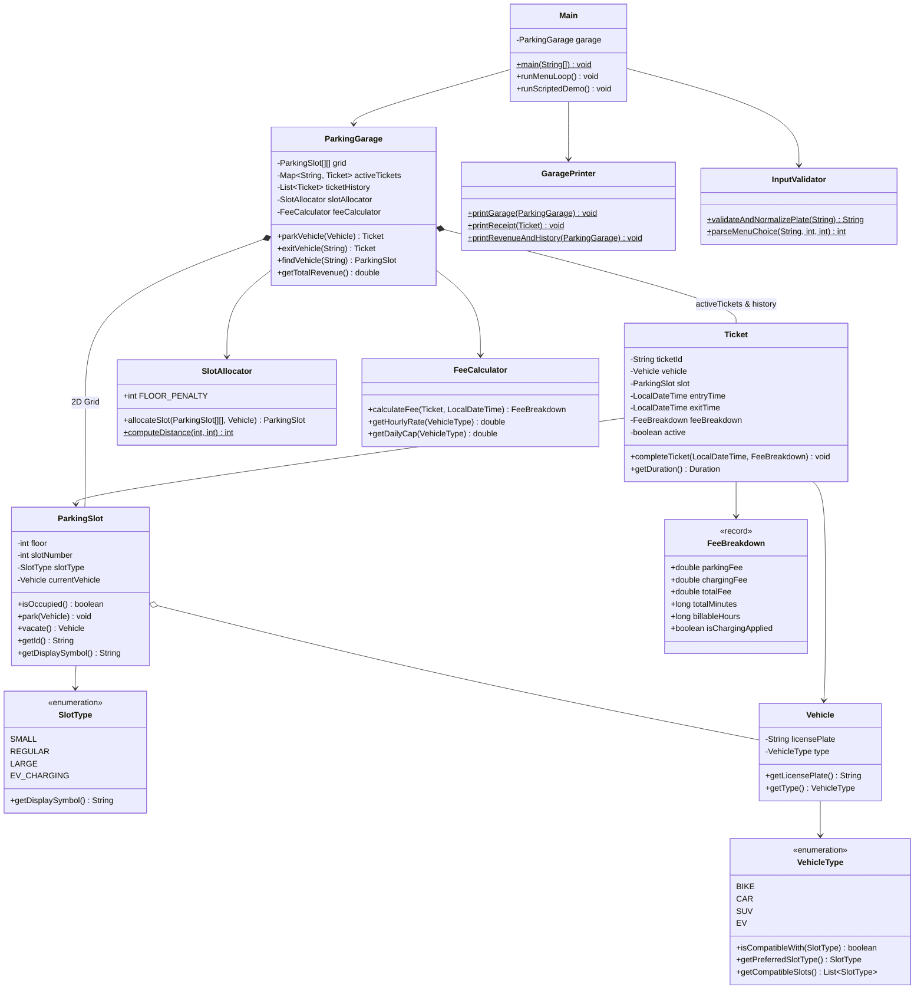
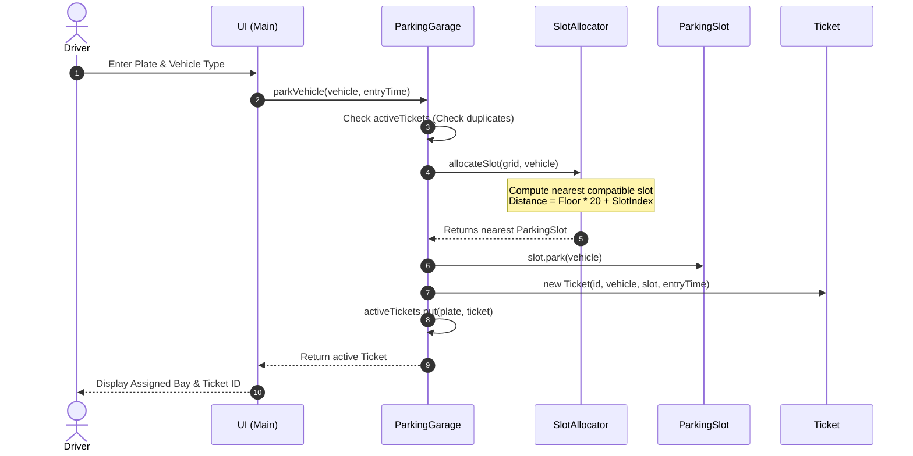
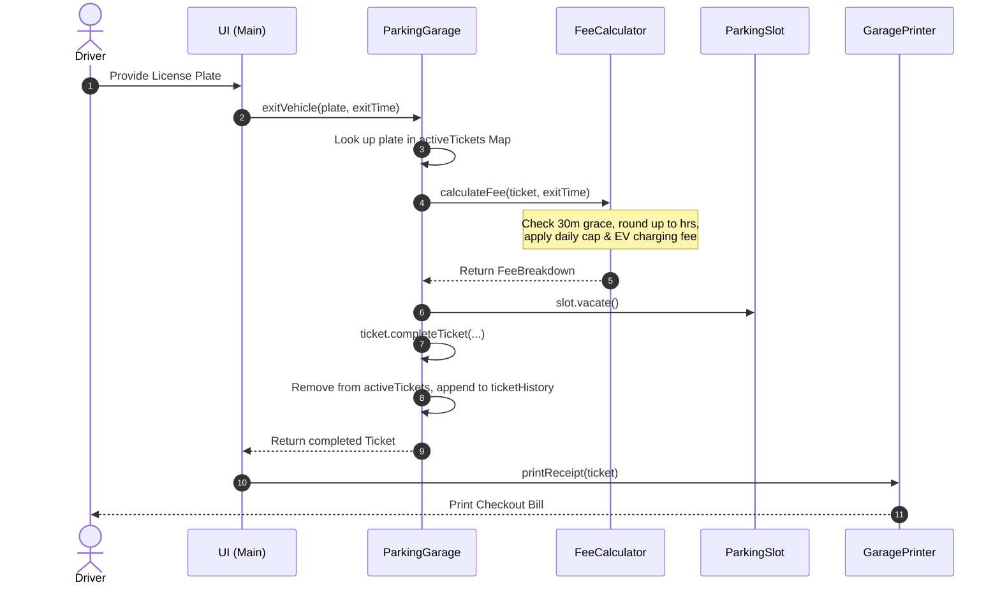

# 🚗 Easyparking: Smart Multi-Storey Automated Car Parking System

> **A lightweight, automated parking management system in plain Java 17 & Maven.**  
> Built for clarity, clean OOP architecture, and effortless operation with zero external frameworks.

---

## 🌟 What Makes Easyparking Easy?

1. **⚡ Zero Guesswork Slot Routing**: Drivers never have to hunt for parking bays. An automated distance formula (`floor × 20 + slotIndex`) routes every vehicle to the nearest free and compatible bay relative to the exit.
2. **🔌 Smart EV Allocation & Fallback**: Automatically prioritizes dedicated EV charging bays (Flat ₹60 + ₹15/hr). If all charging bays are occupied, it automatically routes EVs to regular bays with ₹0 charging surcharge.
3. **💰 100% Automated Tariff & Billing**: Transparent financial calculations featuring a 30-minute free grace period, `Math.ceil` hourly rounding, vehicle-tiered rates (Bike: ₹10/h, Car: ₹30/h, SUV: ₹50/h, EV: ₹40/h), and 24-hour daily caps.
4. **🔍 Instant O(1) Plate Indexing**: Valet retrieval locates any parked vehicle across all 3 floors in constant time using license plate hashing.
5. **🏢 Clean Visual 2D Dashboard**: Minimalist dark-green & white interface with instant color recognition: **Light Green = Available**, **Red = Occupied**, with direct 1-click park, exit, and printable receipts.
6. **📦 Zero External Dependencies**: 100% plain Java 17 with built-in `com.sun.net.httpserver` — no Spring Boot, no Node.js/npm, no database installation required. Just clone and run!

---

## 📌 Project Overview / प्रोजेक्ट अवलोकन

The **Smart Parking Garage** is a console-based multi-storey vehicle parking management system. It models an intelligent commercial parking building with 3 floors and 10 parking slots per floor (expandable). 

The garage accepts four types of vehicles (**BIKE, CAR, SUV, EV**) and automatically routes them to the **nearest free and compatible slot relative to the garage exit (Floor 0, Slot 0)** using a specialized distance-penalty algorithm. It also features automatic tariff computation with a 30-minute grace period, hourly ceiling rounding, daily caps, and EV charging station billing.

---

## 👥 Three-Member Student Ownership / छात्रों का कार्य विभाजन

This project is divided cleanly among 3 students so each person can present and defend their individual module:

| Student Role | Domain | Responsibilities & Files Owned |
| :--- | :--- | :--- |
| **Member 1 (Backbone)** | **Data Architecture & Garage State** | `member1/VehicleType.java`, `member1/SlotType.java`, `member1/Vehicle.java`, `member1/ParkingSlot.java`, `member1/Ticket.java`, `member1/ParkingGarage.java` |
| **Member 2 (Brain)** | **Algorithms & Pricing Logic** | `member2/SlotAllocator.java`, `member2/FeeCalculator.java`, `member2/FeeBreakdown.java` |
| **Member 3 (Face)** | **UI, Validation, Exceptions & QA** | `member3/GaragePrinter.java`, `member3/Main.java`, `member3/InputValidator.java`, `member3/*Exception.java`, all Unit Tests (`src/test/java/garage/*Test.java`), `README.md`, `DEMO_SCRIPT.md` |

*(Every file contains bilingual English & Hindi comments explaining how and why each component works).*

---

## ✨ Key Features & Business Rules

1. **2D Multi-Storey Garage Grid (`ParkingSlot[3][10]`)**:
   - Level 0 (Ground floor), Level 1, Level 2.
   - Slot distribution per floor:
     - Slots `0-1`: `SMALL` (Bikes)
     - Slots `2-6`: `REGULAR` (Cars)
     - Slot `7`: `LARGE` (SUVs)
     - Slots `8-9`: `EV_CHARGING` (Electric Vehicles with charging plugs)
   - Exit is located at **Floor 0, Slot 0**.

2. **Centralized Vehicle Compatibility**:
   - `BIKE`: Compatible with `SMALL`, `REGULAR`, `LARGE` (prefers `SMALL`).
   - `CAR`: Compatible with `REGULAR`, `LARGE` (prefers `REGULAR`).
   - `SUV`: Compatible with `LARGE` only.
   - `EV`: Prefers `EV_CHARGING`; if none are free, seamlessly falls back to `REGULAR` or `LARGE` with an explicit notice:  
     `"[NOTICE] No EV slot free, assigned regular slot (no charging)."`

3. **Nearest-Free-Slot-To-Exit Algorithm**:
   - Metric: $\text{Distance} = (\text{floor} \times \text{FLOOR\_PENALTY}) + \text{slotIndex}$ (where $\text{FLOOR\_PENALTY} = 20$).
   - Driving up ramps incurs a heavy penalty, prioritizing ground-floor bays near the exit.
   - Pure functional design: never mutates grid state during calculation.

4. **Transparent Fee Calculator**:
   - **First 30 minutes FREE** (grace period).
   - Any duration exceeding 30 minutes rounds UP to full hours (`Math.ceil`).
   - **Hourly Rates**: Bike: ₹10/hr | Car: ₹30/hr | SUV: ₹50/hr | EV: ₹40/hr.
   - **EV Charging**: Flat ₹60 connection fee + ₹15/hr (applied *only* if parked in an `EV_CHARGING` bay; ₹0 if assigned fallback slot).
   - **24-Hour Daily Cap**: Bike: ₹80 | Car: ₹250 | SUV: ₹400 | EV: ₹350. Multi-day stays apply daily caps per 24-hour cycle.

5. **Safety, Validation & Custom Exceptions**:
   - Indian license plate regex validation (`^[A-Z]{2}\d{2}[A-Z]{1,2}\d{4}$`).
   - Custom exceptions: `DuplicateVehicleException`, `VehicleNotFoundException`, `GarageFullException`, `InvalidInputException`.

---

## 🚀 How to Run the Project / प्रोजेक्ट कैसे चलाएं

### Prerequisites
- **Java 17+** (JDK 17 or higher)
- **Maven 3.6+** (An embedded Maven wrapper is also included)

### 1. Compile & Launch the Application (One Command)
```bash
# Using standard Maven:
mvn compile exec:java

# Or on Windows using the included wrapper:
.\mvn.cmd compile exec:java
```

### 2. Run the Automated Scripted Demo (Option 6 from Menu or Direct CLI)
```bash
# Direct demo launch via CLI argument:
.\mvn.cmd compile exec:java "-Dexec.args=--demo"
```

### 3. Launch Web Dashboard in Browser (GUI Mode)
```bash
# Direct web dashboard launch:
.\mvn.cmd compile exec:java "-Dexec.args=--web"
```
*(Starts the built-in Java HTTP server and automatically opens `http://localhost:8080` in your default browser).*

### 4. Run All Unit Tests
```bash
mvn test
# or
.\mvn.cmd test
```

---

## 📊 Live Console Output (Sample Demo Run)

```text
===========================================================================
               🚀 RUNNING SCRIPTED AUTOMATED DEMO 🚀
===========================================================================
Simulating real-world garage operations with 10 mixed vehicles...

--- STEP 1: PARKING 10 MIXED VEHICLES ---
  ✓ Parked #01: MH12BK0001   (BIKE) -> Assigned: F0-S00  (Small Slot (Bikes))
  ✓ Parked #02: DL01CR2002   (CAR ) -> Assigned: F0-S02  (Regular Slot (Cars))
  ✓ Parked #03: KA05SV3003   (SUV ) -> Assigned: F0-S07  (Large Slot (SUVs))
  ✓ Parked #04: MH01EV1001   (EV  ) -> Assigned: F0-S08  (EV Charging Slot)
  ✓ Parked #05: MH01EV1002   (EV  ) -> Assigned: F0-S09  (EV Charging Slot)
  ✓ Parked #06: KA01EV2001   (EV  ) -> Assigned: F1-S08  (EV Charging Slot)
  ✓ Parked #07: KA01EV2002   (EV  ) -> Assigned: F1-S09  (EV Charging Slot)
  ✓ Parked #08: DL04EV3001   (EV  ) -> Assigned: F2-S08  (EV Charging Slot)
  ✓ Parked #09: DL04EV3002   (EV  ) -> Assigned: F2-S09  (EV Charging Slot)
[NOTICE] No EV slot free, assigned regular slot (no charging).
  ✓ Parked #10: HR26EV4001   (EV  ) -> Assigned: F0-S03  (Regular Slot (Cars))

--- STEP 2: LIVE GARAGE MAP AFTER PARKING ---
╔═════════════════════════════════════════════════════════════════════════╗
║                SMART PARKING GARAGE - LIVE 2D FLOOR MAP                 ║
╚═════════════════════════════════════════════════════════════════════════╝
  Total Floors: 3 | Bays per Floor: 10 | Total Capacity: 30 | Active: 10 | Free: 20
  Exit Location: [Floor 0, Slot 0] (Ground Level Ramp)
===========================================================================
  Floor 2   | Slot: [00] [01] [02] [03] [04] [05] [06] [07] [08] [09] 
  [Level 2] | Bay:  [s]  [s]  [ ]  [ ]  [ ]  [ ]  [ ]  [L]  [E]  [E]  
           └─> Floor 2 Summary: 2/10 occupied (20.0% full)
---------------------------------------------------------------------------
  Floor 1   | Slot: [00] [01] [02] [03] [04] [05] [06] [07] [08] [09] 
  [Level 1] | Bay:  [s]  [s]  [ ]  [ ]  [ ]  [ ]  [ ]  [L]  [E]  [E]  
           └─> Floor 1 Summary: 2/10 occupied (20.0% full)
---------------------------------------------------------------------------
  Floor 0   | Slot: [00] [01] [02] [03] [04] [05] [06] [07] [08] [09] 
  [Level 0] | Bay:  [B]  [s]  [C]  [E]  [ ]  [ ]  [ ]  [S]  [E]  [E]  
           └─> Floor 0 Summary: 6/10 occupied (60.0% full)
---------------------------------------------------------------------------

--- STEP 4: CHECKOUT RECEIPT (3-HOUR STAY) ---
╔═══════════════════════════════════════════════════════════════════════╗
║                    SMART PARKING GARAGE RECEIPT                       ║
║                         PARKING CHECKOUT                              ║
╠═══════════════════════════════════════════════════════════════════════╣
║  Ticket Number   : TKT-1002                                           ║
║  License Plate   : DL01CR2002                                         ║
║  Vehicle Type    : Sedan / Hatchback Car                              ║
║  Allocated Slot  : F0-S02 (Regular Slot (Cars))                       ║
╟───────────────────────────────────────────────────────────────────────╢
║  Entry Timestamp : 17-Nov-2026 13:42:51                               ║
║  Exit Timestamp  : 17-Nov-2026 16:42:51                               ║
║  Actual Stay     : 3 hours, 0 minutes (180 total mins)                ║
║  Billable Hours  : 3 hr(s) [rounded up]                               ║
╟───────────────────────────────────────────────────────────────────────╢
║                          FEE BREAKDOWN                                ║
║  Base Parking Fee: ₹90.00                                             ║
╟───────────────────────────────────────────────────────────────────────╢
║  TOTAL AMOUNT PAID : ₹90.00 INR                                       ║
║  Status            : PAID & COMPLETED                                 ║
╚═══════════════════════════════════════════════════════════════════════╝
```

---

## 📐 Architecture & Class Diagram (Mermaid)



---

## 🔄 Lifecycle Flows

### 1. Vehicle Parking Flow (`parkVehicle`)


### 2. Vehicle Checkout Flow (`exitVehicle`)


---

## 🧠 Nearest-Slot Algorithm Explained in Simple Words

Imagine a 3-storey building. The exit ramp is at **Floor 0, Slot 0**.
- Walking or driving across adjacent slots on the **same floor** takes very little time.
- Driving up a ramp to **Floor 1 or Floor 2** takes significant time, effort, and fuel.

To represent this realistic human behavior in software, we define:
$$\text{Distance Score} = (\text{Floor Level} \times 20) + \text{Slot Index}$$

### Example Calculation:
- **Floor 0, Slot 5**: $(0 \times 20) + 5 = \mathbf{5}$ points.
- **Floor 0, Slot 9**: $(0 \times 20) + 9 = \mathbf{9}$ points.
- **Floor 1, Slot 0**: $(1 \times 20) + 0 = \mathbf{20}$ points.
- **Floor 2, Slot 0**: $(2 \times 20) + 0 = \mathbf{40}$ points.

Because 5 is smaller than 20, the algorithm will always fill free slots on Ground Floor before sending any car up the ramp to Floor 1!

---

## 📂 Project Directory Structure

```text
smart-parking-garage/
├── pom.xml                                   # Maven build descriptor (Java 17 & JUnit 5)
├── mvn.cmd                                   # Windows Maven launcher wrapper
├── mvn                                       # Linux/macOS bash launcher wrapper
├── README.md                                 # Complete project documentation
├── TEAM_DUTIES.md                            # 3-Member responsibilities & Viva Q&A
├── DEMO_SCRIPT.md                            # 5-minute presentation script
└── src/
    ├── main/java/
    │   ├── member1/                          # 👤 MEMBER 1 (Backbone) - Models & State
    │   │   ├── VehicleType.java              # Vehicle enum & centralized compatibility rules
    │   │   ├── SlotType.java                 # Slot classification enum
    │   │   ├── Vehicle.java                  # Vehicle POJO (plate, type)
    │   │   ├── ParkingSlot.java              # Individual slot bay (floor, index, occupancy)
    │   │   ├── Ticket.java                   # Parking session record
    │   │   └── ParkingGarage.java            # Multi-storey state coordinator
    │   ├── member2/                          # 👤 MEMBER 2 (Brain) - Algorithms & Pricing
    │   │   ├── FeeBreakdown.java             # Immutable record for tariff details
    │   │   ├── SlotAllocator.java            # Nearest-slot pure allocation algorithm
    │   │   └── FeeCalculator.java            # Tariff & EV billing logic
    │   └── member3/                          # 👤 MEMBER 3 (Face) - UI, Web & Validation
    │       ├── GaragePrinter.java            # 2D ASCII visualizer & receipt formatter
    │       ├── Main.java                     # Console interactive menu & scripted demo
    │       ├── WebServer.java                # Built-in Java HTTP Server & REST API
    │       ├── InputValidator.java           # Regex plate validation & safe parsing
    │       ├── GarageFullException.java      # Thrown when no compatible bay is free
    │       ├── VehicleNotFoundException.java # Thrown when plate not found
    │       ├── DuplicateVehicleException.java# Thrown on double entry
    │       └── InvalidInputException.java    # Thrown on invalid console input
    ├── resources/
    │   └── web/
    │       └── index.html                    # Single-Page Web Dashboard (Pure HTML/CSS/JS)
    └── test/java/garage/
        ├── FeeCalculatorTest.java            # 6 tests for grace period, caps, EV fees
        ├── SlotAllocatorTest.java            # 7 tests for distance, sizes, EV fallback
        └── ParkingGarageTest.java            # 7 tests for park/exit lifecycle & revenue
```

